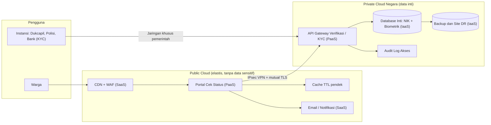

# Diagram Arsitektur Hybrid Cloud: Sistem Data Kependudukan

**Keterangan:**
- Data sensitif hanya ada di Private Cloud. Public Cloud hanya menyimpan hasil minimal dan cache.
- Saat lonjakan (pemilu, pendaftaran sekolah), hanya segmen Public yang di-scale out (cloud bursting).
- Satu-satunya jalur antar segmen adalah VPN terenkripsi lewat API Gateway.
